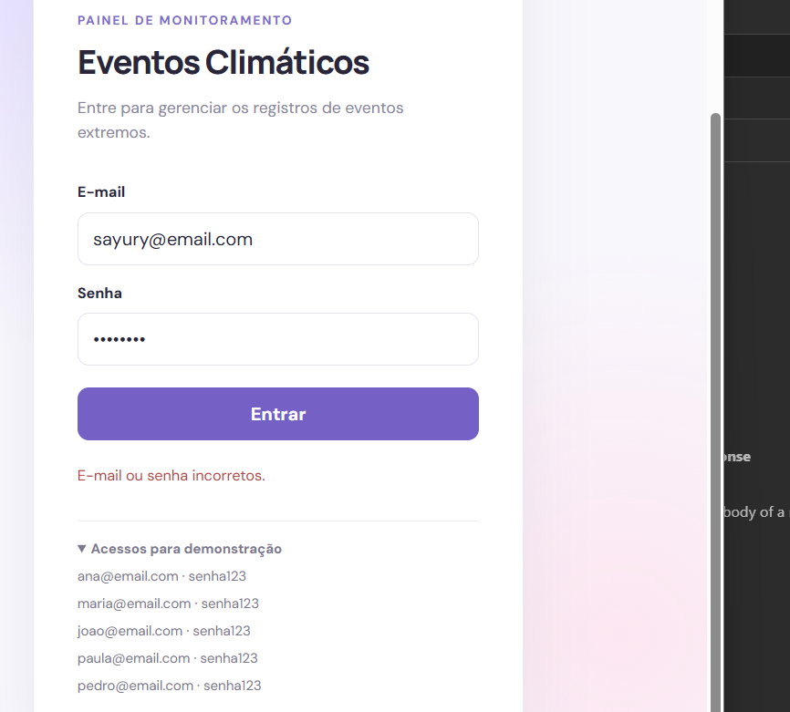
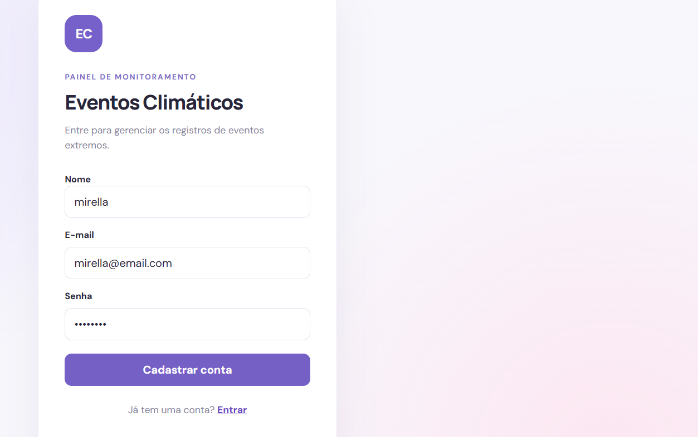
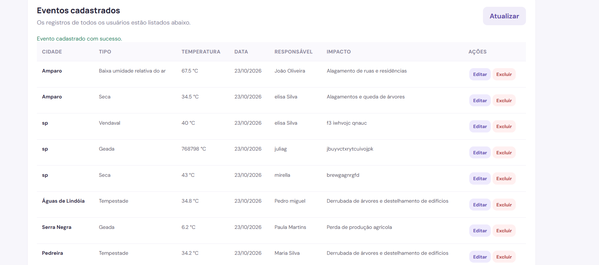
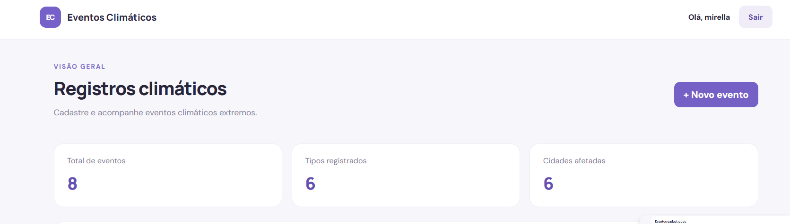
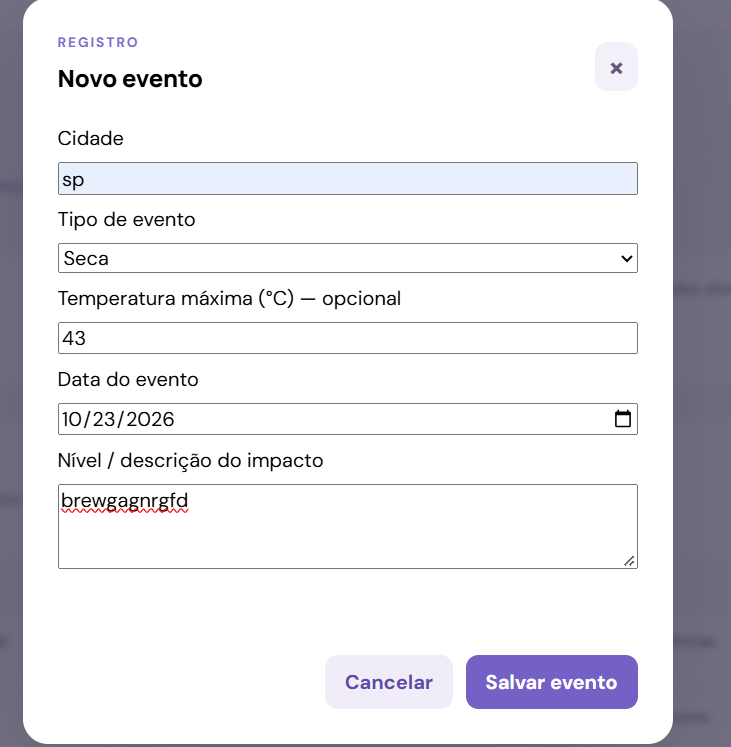
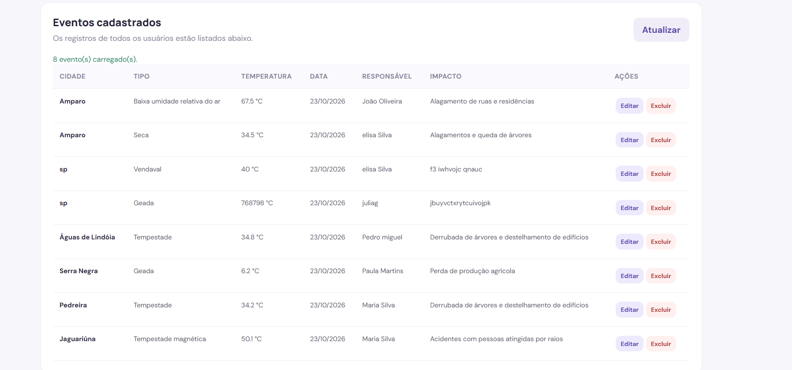
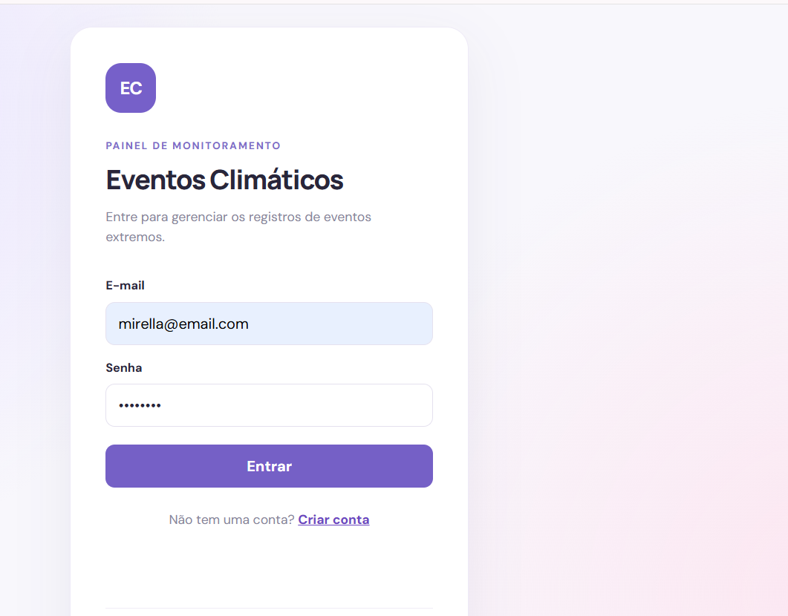
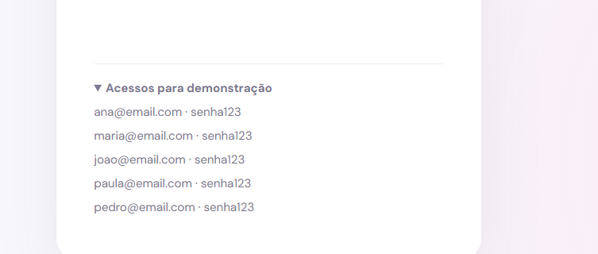

# Eventos Climáticos — Projeto Full Stack

Projeto didático da Aula 05 — Prisma Seed, desenvolvido com Node.js, Express, Prisma 7, MySQL e frontend em HTML, CSS e JavaScript.

## Requisitos

- Node.js 20.19+
- MySQL em execução (XAMPP)
- Banco de dados `eventos`                                                                                                                                                                                                         
-git clone do meu projeto entrar na pasta eventos_climaticos
## 1. Configurar o banco

Criar o banco de dados:

```sql
CREATE DATABASE eventos;
```

## 2. Instalar e configurar a API

No terminal, dentro da pasta `api`:

```bash
npm install
```

Configure o arquivo `.env`:

```env
PORT=3000
DATABASE_URL="mysql://root@localhost:3306/eventos"
DB_HOST="localhost"
DB_PORT="3306"
DB_USER="root"
DB_PASSWORD=""
DB_NAME="eventos"
```

## 3. Prisma e Seed

Execute os comandos dentro da pasta `api`:

```bash
npx prisma generate
npx prisma migrate dev --name init
npx prisma db seed
npm run dev
```

Se a migração e o seed já foram executados, não precisa repeti-los.

A API estará disponível em `http://localhost:3000`.

**Atenção:** o seed apaga usuários e eventos existentes antes de inserir os dados de exemplo.

## 4. Frontend

Abra `web/index.html` no navegador. Se necessário, execute dentro da pasta `web`:

```bash
npx serve .
```

## 5. Login de demonstração

Todos utilizam a senha `senha123`.

- ana@email.com
- maria@email.com
- joao@email.com
- paula@email.com
- pedro@email.com

## 6. Rotas para o Insomnia

**Base URL:** `http://localhost:3000`

### Usuários

| Método | Rota |
|---|---|
| POST | `/usuario/cadastrar` |
| POST | `/usuario/login` |
| GET | `/usuario/listar` |
| GET | `/usuario/buscar/:id` |
| PUT | `/usuario/atualizar/:id` |
| DELETE | `/usuario/excluir/:id` |

### Eventos

| Método | Rota |
|---|---|
| POST | `/evento/cadastrar` |
| GET | `/evento/listar` |
| GET | `/evento/buscar/:id` |
| PUT | `/evento/atualizar/:id` |
| DELETE | `/evento/excluir/:id` |

Organize as requisições no Insomnia em grupos de **Usuários** e **Eventos**.

## 7. Funcionalidades

- Cadastro e login de usuários.
- CRUD de eventos climáticos.
- Associação de eventos aos usuários.
- Seed com 5 usuários e 8 eventos.

## 8. Prints do projeto

### Print 1 —Senha invalida mas email valido

  


### Print 2 — Senha valida  e email tbm

  


  
### Print 3 — Todos os eventos cadastrado ate o momento

   


### Print 4 — A visão de cima

  
  
  

### Print 5 — Cadastro de evento

  
  
  

### Print 6 — Todos os eventos anteriores mais esse novo
  
  
  
  

  

### Print 7 — Login

  
  
  

### Print 8 — Demostração

  
  


## Observação final

Confirme se as rotas documentadas correspondem às implementadas nos arquivos do backend e se os testes foram executados corretamente.
